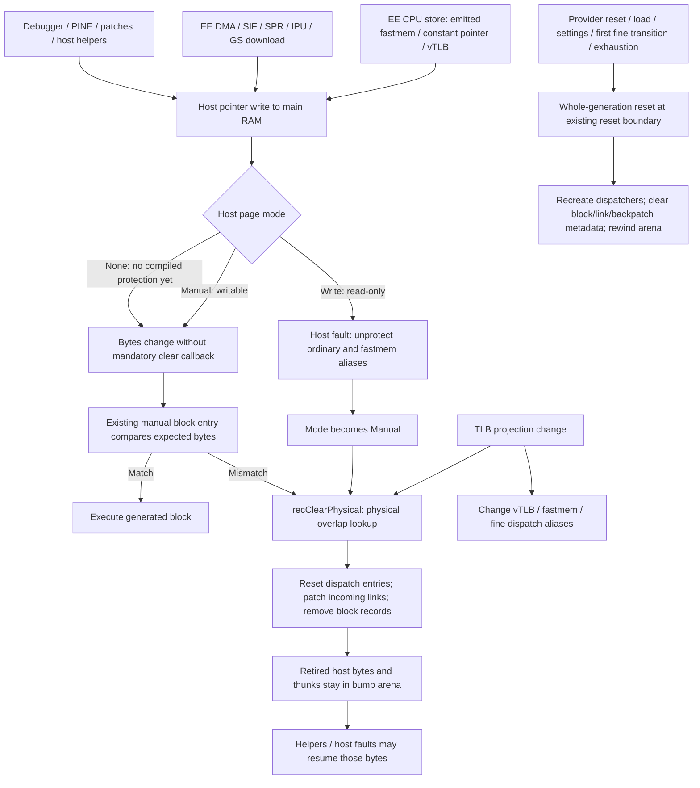

# EE JIT physical writers, invalidation and host-code lifetime audit (v28)

Source checkpoint: `86ed1f2fe3dc2f05f2ed8ea2d581449c8716c334`, branch
`note-working/psbbn-jit-reiserfs-mmu-witness-20261020`, 2026-10-21.
Read-only source audit; this new note is the only file written by this audit.
Read AGENTS, v26 mission, v27 invariants and v25 review. No compilation, CMake,
C++ test execution, guest execution, guest images, commit or push performed.
Line anchors below refer to that checkpoint, before concurrent mission edits.

## Findings that constrain persistent code versions

Current instruction-write coherence is principally **host write protection followed
by manual entry integrity checks**, not a producer-wide physical content epoch.
SIF explicitly documents this policy. A raw writer is therefore not automatically
a missed current invalidation; on protected main RAM its write faults, clears
blocks and changes the page to manual mode. Subsequent writes to a manual page
need not fault or call any clear function. Reusing dormant code with only an
epoch advanced in `recClearPhysical` would consequently be unsound.

Source establishes selected barriers and identifies substantial unproved coverage:

1. Main-RAM protected writes have a common page-fault barrier; manual blocks
   compare instruction bytes at entry. This is not proof that a currently
   executing block stops immediately after writing its own later instruction,
   that every cross-page physical source is covered, or that all producer threads
   are synchronized with code-cache mutations.
2. A complete producer/content-version barrier is missing as an abstraction.
   PINE, debugger, achievement integration, DMA, interpreter cache writeback and
   raw BIOS/launch helpers have distinct write paths. Every one must be connected
   to new epochs, retain an effective protection/watch protocol, or be fenced by
   a whole-cache generation transition before persistent versions are admissible.
3. `BaseBlocks::Remove` explicitly permits exception/event handlers to return to
   invalidated generated code. Ordinary clear is retirement, not reclamation.
   Backpatch thunks likewise jump back into the retired caller. No per-block
   allocation owner or all-frame quiescence mechanism is established here.
4. Incoming links are target-indexed; outgoing patch addresses survive source
   deletion. Their safety depends on arena storage remaining allocated until a
   full reset clears all links. Reusing those addresses individually is blocked.
5. `recTLBWI`, `recTLBWR` and EntryHi writes return from their helpers without an
   explicit dispatcher side exit at those emitter sites. Entry guards alone
   cannot validate later instructions/data accesses in that same generated block.
   Preserve conservative invalidation; establish an actual continuation boundary.
6. ROM and scratchpad must have separate policies. Main-RAM protection/version
   reasoning does not cover either, and scratchpad is not an ordinary compilable
   RAM dispatch page in the inspected implementation.

Unknown producer barriers are explicit **blockers**, not permission to assume
that current ordinary clears cover persistent versions or independent reclamation.
This note does not assert a newly reproduced runtime defect.

## Lifecycle diagram and identities

`BASEBLOCK` is a dispatch function pointer, `BASEBLOCKEX` is physical-start/extent
metadata, and `BaseBlocks::links` maps a target physical PC to **host displacement
addresses in callers**. These are different objects from `recLUTPages` VPN aliases,
fastmem mappings, fault records, instruction RAM and executable arena storage.
See [BaseblockEx.h:14](../pcsx2/x86/BaseblockEx.h#L14),
[BaseblockEx.h:24](../pcsx2/x86/BaseblockEx.h#L24),
[BaseblockEx.h:146](../pcsx2/x86/BaseblockEx.h#L146).

## Physical producer inventory and actual barriers

Classification: **established local** means the cited code implements the stated
barrier, **conditional** means it depends on main-RAM protection/manual checking,
and **unproved** means the additional coverage or scheduling requirement has not
been established by this audit. None means executable end-to-end validation.

| Producer / exact source path | Writes and known local barrier | Coverage limit for retained versions |
|---|---|---|
| EE interpreter `vtlb_memWrite<T>` / `vtlb_memWrite128`, [vtlb.cpp:255](../pcsx2/vtlb.cpp#L255), [:306](../pcsx2/vtlb.cpp#L306) | Check architectural D before side effects, then direct host store or handler; interpreter may instead write its emulated data cache. No universal physical-clear callback per store. | Conditional main-RAM SMC protection; cache writeback is a separate eventual writer. D permission is distinct from host protection. |
| EE generated stores, [iR5900.cpp:2247](../pcsx2/x86/ix86-32/iR5900.cpp#L2247), `recVTLB.cpp` | Memory opcode flush/PC/BD setup and fine-mode `recCheckTLBStore` precede emission; fastmem and constant-pointer stores bypass interpreter vTLB writer. | EntryLo.D helper is not an instruction-content generation update. Every emitted store width/RMW and all physical source pages still need producer/entry proof. |
| Host SMC fault, `mmap_MarkCountedRamPage`, `mmap_ClearCpuBlock`, `HandlePageFault`, [vtlb.cpp:1501](../pcsx2/vtlb.cpp#L1501), [:1531](../pcsx2/vtlb.cpp#L1531), [:1552](../pcsx2/vtlb.cpp#L1552) | Protect main RAM and fastmem aliases read-only; fault changes both to read-write, marks Manual, calls physical clear for host-page bytes/dwords, then continues execution. | Established local barrier for protected main RAM. Manual writes deliberately avoid further faults; this is not a per-write epoch. Fault resumes interrupted host execution. |
| Manual SMC entry checks, `memory_protect_recompiled_code`, [iR5900.cpp:2469](../pcsx2/x86/ix86-32/iR5900.cpp#L2469), `dyna_block_discard` [:2453](../pcsx2/x86/ix86-32/iR5900.cpp#L2453) | Generated compare per expected dword; mismatch jumps to discard dispatcher; counted blocks periodically clear/reprotect page. Special thread-context pages start manual. | Conditional: existing checks walk a contiguous physical span from `HWADDR(startpc)`. Does not establish noncontiguous second-PFN integrity or a mid-block recheck. |
| Interpreter data-cache eviction / `CACHE` / `writebackCache`, `CacheLine::writeBackIfNeeded`, [Cache.cpp:114](../pcsx2/Cache.cpp#L114), [:182](../pcsx2/Cache.cpp#L182), [:386](../pcsx2/Cache.cpp#L386) | Dirty/valid cache data is assigned directly to host physical pointer. | Conditional main-RAM fault; account content when RAM actually changes. `recCACHE` is empty in [iR5900Misc.cpp:201](../pcsx2/x86/iR5900Misc.cpp#L201); do not claim JIT models every guest cache op. |
| EE SIF0 / SIF2 FIFO-to-memory, `WriteFifoToEE`, [Sif0.cpp:24](../pcsx2/Sif0.cpp#L24), [sif2.cpp:50](../pcsx2/sif2.cpp#L50) | FIFO reads into `DMACh::getAddr(...,true)` pointer. Comments at SIF0 :42 and SIF2 :68 explicitly say protection/manual blocks handle clearing; `Cpu->Clear` is commented out. | Conditional main-RAM barrier; direct physical-write epoch absent. SPR destinations have separate coverage. |
| IOP/DEV9/CDVD/SPU/USB producers | `psxDma8`, [IopDma.cpp:152](../pcsx2/IopDma.cpp#L152), passes **IOP** physical memory to `DEV9readDMA8Mem`, then `psxCpu->Clear`; CDVD likewise clears IOP blocks, [CDVD.cpp:1243](../pcsx2/CDVD/CDVD.cpp#L1243). EE delivery proceeds through SIF0/SIF2 or EE CPU accesses. | Do not invent direct ATA-to-EE RAM writes or treat `psxCpu->Clear` as an EE barrier. Audit IOP producer completion and SIF destination independently. |
| EE IPU output `IPU0dma`, [IPUdma.cpp:140](../pcsx2/IPU/IPUdma.cpp#L140), [:176](../pcsx2/IPU/IPUdma.cpp#L176); FIFO copy [IPU_Fifo.cpp:146](../pcsx2/IPU/IPU_Fifo.cpp#L146) | `dmaGetAddr(...,true)` then `ipu_fifo.out.read` copies bytes. | Conditional main-RAM fault/manual checking; no direct EE clear in output routine. |
| SPR0 normal/chain/interleave, `_SPR0chain`, `_SPR0interleave`, [SPR.cpp:102](../pcsx2/SPR.cpp#L102), [:171](../pcsx2/SPR.cpp#L171) | Copy from scratchpad to pointer from `SPRdmaGetAddr(...,true)`; `TestClearVUs` separately clears VU microcode. | Main RAM conditional SMC barrier; VU clear is not an EE clear. Scratch/VU/zero-buffer destinations require correct object identity. |
| MFIFO `hwMFIFOWrite`, [Hw.cpp:125](../pcsx2/Hw.cpp#L125) | Wrapped copy into `PSM(RBOR)` physical ring. | Conditional main-RAM protection; cover both wrapped spans in any future content accounting. |
| SPR1 writes to scratchpad, `memcpy_to_spr`, [SPR.cpp:72](../pcsx2/SPR.cpp#L72), `_SPR1interleave` [:391](../pcsx2/SPR.cpp#L391) | Wrapped scratchpad memcpy. | Not covered by main-RAM SMC page tracking; do not create ordinary RAM content versions for this by address masking. |
| GS reverse download / VIF1, `vif1TransferToMemory`, [Vif1_Dma.cpp:25](../pcsx2/Vif1_Dma.cpp#L25), `MTGS::InitAndReadFIFO`, [MTGS.cpp:283](../pcsx2/MTGS.cpp#L283) | Destination from `dmaGetAddr`; normal path queues pointer and immediately waits for GS. Unsynchronized download setting uses direct GS helper or memset on caller. | MTGS explicitly installs secondary fault handler and documents waiting-based safety at [:148](../pcsx2/MTGS.cpp#L148). This is concrete scheduling evidence for this producer, not proof for all workers. |
| GIF, VIF0, VIF1 upload, IPU1, SIF1 | `dmaGetAddr(...,false)` / `PSM` are EE-memory sources, e.g. [Gif.cpp:345](../pcsx2/Gif.cpp#L345), [Vif0_Dma.cpp:35](../pcsx2/Vif0_Dma.cpp#L35), [IPUdma.cpp:33](../pcsx2/IPU/IPUdma.cpp#L33), [Sif1.cpp:62](../pcsx2/Sif1.cpp#L62). SIF1 destination clear is IOP. | Do not count read-only DMA channels as EE instruction writers. VIF1 reverse mode is the separate row above. |
| Pointer resolvers, [Dmac.cpp:81](../pcsx2/Dmac.cpp#L81), [:149](../pcsx2/Dmac.cpp#L149) | Return direct main-RAM, scratchpad, VU, or zero buffers. `write` selects zero read/write buffers in the hole; it does not invoke a write barrier. | Any future barrier belongs at actual transfer spans/completion or protected mapping, not merely pointer acquisition. |
| Debugger `R5900DebugInterface::Write*`, [DebugInterface.cpp:283](../pcsx2/DebugTools/DebugInterface.cpp#L283), [:308](../pcsx2/DebugTools/DebugInterface.cpp#L308) | `vtlb_memSafeWriteBytes` page-chunks memcpy, [vtlb.cpp:438](../pcsx2/vtlb.cpp#L438). | Conditional protection; no per-page clear/version call in safe writer. It can partially write preceding pages before rejecting a later handler page. Caller pause/thread discipline needs independent proof. |
| PINE writes, [PINE.cpp:593](../pcsx2/PINE.cpp#L593), `vtlb_ramWrite<T>` [vtlb.cpp:371](../pcsx2/vtlb.cpp#L371) | Direct memcpy through vmap pointer; no physical-clear call. Server names its own thread at [:417](../pcsx2/PINE.cpp#L417) and calls parser at :474. | **Unproved synchronization blocker:** inspected write cases run directly, unlike save/load cases using `RunOnCPUThread` at :647/:661. Host protection alone does not establish race-free code metadata mutation; width write also has no chunked cross-page routine. |
| RAIntegration memory poke, [Achievements.cpp:3963](../pcsx2/Achievements.cpp#L3963) | Bounds check then raw memcpy to main RAM or scratchpad. | Conditional protected main RAM; caller thread/quiescence and scratchpad policy unproved here. Build-conditional producer must be included when enabled. |
| Legacy DECI2 debugger, [deci2_dbgp.cpp:283](../pcsx2/RDebug/deci2_dbgp.cpp#L283), [:293](../pcsx2/RDebug/deci2_dbgp.cpp#L293), argument upload [:377](../pcsx2/RDebug/deci2_dbgp.cpp#L377) | Raw memcpy through physical pointer (separate IOP/VU branches). | Unproved activation/thread/range barrier; retain as conditional or inactive producer to verify, not silently omit it. |
| Boot/continuous cheats, `Patch::ApplyPatch`, [Patch.cpp:1707](../pcsx2/Patch.cpp#L1707), `ApplyBootPatches` :1101, `ApplyVsyncPatches` :1110 | `MemoryInterface::IdempotentWrite*`, [MemoryInterface.cpp:104](../common/MemoryInterface.cpp#L104), compare first then route to EEMemoryInterface scalar `memWrite*` or byte safe writer, [Memory.cpp:1230](../pcsx2/Memory.cpp#L1230). | Idempotence prevents unchanged-byte host writes but is not a changed-byte generation barrier. Continuous patches use existing conditional SMC path. Boot patches also get the entrypoint reset below. |
| Dynamic patches, `ApplyDynaPatch`, [Patch.cpp:1812](../pcsx2/Patch.cpp#L1812), invoked during `recompileNextInstruction`, [iR5900.cpp:2083](../pcsx2/x86/ix86-32/iR5900.cpp#L2083) | Read pattern via PSM; replacement via `memWrite32`. Enabling dynamic patches triggers `Cpu->Reset`, [Patch.cpp:816](../pcsx2/Patch.cpp#L816). | Version/hash publication must observe post-patch bytes and exclude partially compiled state; do not derive content identity before dynamic patch application. |
| EELOAD/launch hooks, [R5900.cpp:622](../pcsx2/R5900.cpp#L622), [:682](../pcsx2/R5900.cpp#L682), [:750](../pcsx2/R5900.cpp#L750), [:796](../pcsx2/R5900.cpp#L796); DECI syscall [:224](../pcsx2/R5900OpcodeImpl.cpp#L224) | Raw argument/string/status writes to PSM memory. | Conditional SMC protection; boot context does not justify excluding these from physical write accounting. |
| Reset/BIOS and savestate bulk restore | Lifecycle table below. | Established whole-cache invalidation boundary in reviewed call paths, subject to normal VM-thread/execution ordering. These are generation changes, not ordinary individual writes. |

Ordinary IOP stores target IOP RAM and `psxCpu`, [IopMem.cpp:260](../pcsx2/IopMem.cpp#L260).
IOP reset maps shared EE ROM **read-only in its RLUT**, leaving WLUT empty,
[IopMem.cpp:71](../pcsx2/IopMem.cpp#L71); the `0x2000` offset is the read-table
half of the allocation, not writable EE RAM. EE accesses to IOP RAM go through
the IOP handler at [Memory.cpp:422](../pcsx2/Memory.cpp#L422).

## Event / object mutation table

| Event | Guest bytes / translations | Dispatch and block/link objects | Backpatch / protection / arena objects | Boundary evidence and remaining condition |
|---|---|---|---|---|
| Protected main-RAM write | Mutates RAM after fault retry | `recClearPhysical` -> physical overlap clear; resets dispatch extents; removes blocks; patches incoming links | Unprotects main and fastmem host aliases, marks Manual; arena remains allocated; ordinary clear does not erase all host-IP records | `vtlb.cpp:1531-1589`; interrupted host instruction resumes. No reclamation allowed. |
| Manual-page write | Mutates RAM without required fault | No mandatory immediate cache edit; later entry mismatch discards dependent contiguous block extent | Existing expected-byte checks stay in generated code; periodic page re-protection | `iR5900.cpp:2469-2555`; complete source-range and entry/link checks required. |
| TLB/ASID effective backing changes | `SyncActiveTLBMappings` removes old vmap/fastmem and installs new effective backing | Clears old/new physical pages; removes/remaps fine dispatch aliases | Host alias mappings/protection can change; no arena reclaim; ordinary backpatch records persist | [COP0.cpp:1014](../pcsx2/COP0.cpp#L1014). Does not invalidate all embedded **data** pointers outside the cleared instruction PFNs. |
| D-only effective permission change | Active page map permission changes; identical backing retained | No physical code clear or remap | Host SMC protection stays independent | `COP0.cpp:1062`; fine emitted stores consult current D. Permission helper tests are not full runtime proof. |
| Fastmem load/store fault requiring backpatch | Guest address is resolved through slow vTLB thunk | Calls `Cpu->Clear(guest_pc,1)` so next dispatch recompiles | Emit thunk into same arena; patch old host instruction to JMP thunk; erase that fault entry, remember guest PC | [vtlb.cpp:1154](../pcsx2/vtlb.cpp#L1154), [recVTLB.cpp:917](../pcsx2/x86/ix86-32/recVTLB.cpp#L917). Patched code/thunk can still run after logical clear. |
| Manual integrity mismatch / periodic reset | Bytes unchanged by clear itself | `dyna_block_discard` / `dyna_page_reset` physical clear and dispatcher jump | Page-reset path reprotects host page; no arena reclamation | `iR5900.cpp:2453/2462`; compare helper exits explicitly to DispatcherReg. |
| CPU provider reset | May leave guest bytes unchanged | `recResetEE` resets generation; `recResetRaw` rebuilds dispatch tables, clears blocks and links | Rewinds arena; regenerates dispatchers; clears host-IP/fault-PC metadata, presence bitmap, manual counters and RAM copy | [iR5900.cpp:1168](../pcsx2/x86/ix86-32/iR5900.cpp#L1168), [:1022](../pcsx2/x86/ix86-32/iR5900.cpp#L1022). If executing, defer reset and request safe exit. Block-protection reset is separate. |
| Arena exhaustion | No guest byte change | Reset at compiler boundary; fine/native mode preserved for internal reset | Same arena rewind / metadata clear, guard allowance for thunks | `recRecompile` :2700, `recBeginThunk` :1309. Thunk overflow marks pending reset; does not reclaim caller immediately. Existing dispatcher reset protocol is not general per-segment reclamation proof. |
| First fine dispatch transition | Translation eligibility changes | Mode transition sets reset-needed; native-mode links discarded | Whole-generation reset | `EERecEnterGuestTLBDispatch`, [EERecCodeCache.h:35](../pcsx2/x86/EERecCodeCache.h#L35), `recError` :872 / unavailable-page repair :2650. |
| Savestate load | Bulk replaces EE RAM, scratchpad, architectural TLB/context | `PreLoadPrep` resets providers before restore; `PostLoadPrep` syncs restored TLB projection | Wait VU/GS, reset block protection, clear cache generation; restore is direct zip-to-memory | [SaveState.cpp:50](../pcsx2/SaveState.cpp#L50), [:485](../pcsx2/SaveState.cpp#L485), [:514](../pcsx2/SaveState.cpp#L514), [:1199](../pcsx2/SaveState.cpp#L1199). No JIT host pointers are serialized by these memory entries. Preserve HDD-enabled savestates. |
| VM reset / initial boot | Zero EE memory incl ROM, copy BIOS, reset IOP/VU/registers | Reset protection; set exposed RAM; provider reset; then reset memory and CPU | Whole cache generation invalidated; memory maps rebuilt | [VMManager.cpp:1570](../pcsx2/VMManager.cpp#L1570), [:1838](../pcsx2/VMManager.cpp#L1838), [Memory.cpp:192](../pcsx2/Memory.cpp#L192), [:1157](../pcsx2/Memory.cpp#L1157), [R5900.cpp:60](../pcsx2/R5900.cpp#L60). `cpuReset` alone is not a JIT flush. |
| RAM-size mode change | ExposedRam becomes 32/128 MiB; physical mappings and dispatch allocation depend on it | Reset/boot applies `memSetExtraMemMode` before provider/cache reset; recResetRaw checks mode and reserves LUT/RAM copy | Must retire old generation before resized arrays are used | [Memory.cpp:239](../pcsx2/Memory.cpp#L239), `recReserveRAM` :919. Setter itself only changes size fields. Save state mismatched RAM mode rejected at [Memory.cpp:1176](../pcsx2/Memory.cpp#L1176). Arbitrary live setter is not a validated transition. |
| Interpreter/JIT switch | Guest memory retained | `VMManager::Execute` changes providers and clears newly selected execution caches | `vtlb_ResetFastmem` removes/rebuilds mappings and clears fault tables | [VMManager.cpp:2893](../pcsx2/VMManager.cpp#L2893). Old provider code cannot be reused across unchecked assumptions. |
| CPU/gamefix/speedhack/profiler settings | Some handlers/compiled assumptions change | `CheckForCPUConfigChanges` resets providers; rebinds handlers; actual provider switch deferred to Execute | Fastmem toggle explicitly resets fastmem | [VMManager.cpp:3097](../pcsx2/VMManager.cpp#L3097). Do not replace config-generation invalidation with instruction-content equality. |
| Recognized ELF entry / reload | Boot patches may mutate bytes; guest loaders themselves use ordinary CPU/DMA writers | `EntryPointCompilingOnCPUThread` applies patches then resets block tracking and execution caches | Whole-cache reset requested; compiler honors pending reset | [VMManager.cpp:3019](../pcsx2/VMManager.cpp#L3019), `recRecompile` :2703. `ElfObject::LoadProgramHeaders` parses host ELF metadata, [Elfheader.cpp:259](../pcsx2/Elfheader.cpp#L259), not a universal EE-memory segment loader/barrier for every guest module load. |
| Debug break/memcheck configuration | No required byte change | `CBreakPoints::Update` pauses if necessary and resets selected provider | Generated instrumentation assumptions rebuilt | [Breakpoints.cpp:766](../pcsx2/DebugTools/Breakpoints.cpp#L766). Separate from debugger memory-write barrier. |
| vTLB reset/shutdown/fastmem reset | Clears/rebuilds projection or mappings | `vtlb_Reset` removes mappings and unmaps architectural entries | Shutdown/reset-fastmem clear host-IP/fault-PC tables; plain `vtlb_Reset` has distinct semantics | [vtlb.cpp:1325](../pcsx2/vtlb.cpp#L1325), [:1332](../pcsx2/vtlb.cpp#L1332), [:1341](../pcsx2/vtlb.cpp#L1341). Never infer all three perform the same provider/arena reset. |

`mmap_ResetBlockTracking` explicitly says it **does not clear recompiler blocks**
and requires its caller to reset EErec too, [vtlb.cpp:1591](../pcsx2/vtlb.cpp#L1591).
Likewise `vtlb_ClearLoadStoreInfo` clears metadata only, not code or mappings.

## Host-IP metadata, thunks, links and safepoints

* `s_fastmem_backpatch_info` is keyed by host instruction address and records
  guest PC, register masks, instruction size and memory operation shape,
  [vtlb.cpp:72](../pcsx2/vtlb.cpp#L72). It has no block/segment owner or arena
  generation handle. `vtlb_AddLoadStoreInfo` replaces a record at an identical
  address; ordinary physical clear does not walk/remove all records for the
  removed block. Whole reset `vtlb_ClearLoadStoreInfo` clears both maps at once.
* `vtlb_DynBackpatchLoadStore` obtains `recBeginThunk`, emits register save/restore,
  vTLB access and a jump to `code_address + code_size`, then overwrites the old
  faulting instruction with a jump and NOPs. The thunk and old continuation are
  one lifetime unit for reclaim purposes even though no explicit owner exists.
  See [recVTLB.cpp:1059](../pcsx2/x86/ix86-32/recVTLB.cpp#L1059) and
  [iR5900.cpp:1309](../pcsx2/x86/ix86-32/iR5900.cpp#L1309).
* `BaseBlocks::Link`, [BaseblockEx.cpp:60](../pcsx2/x86/BaseblockEx.cpp#L60), stores
  displacement pointer keyed by target. `New` patches all recorded incoming
  sites to fresh target [:6](../pcsx2/x86/BaseblockEx.cpp#L6); `Remove` patches
  them back to compiler and deliberately leaves outgoing entries (TODO),
  [BaseblockEx.h:191](../pcsx2/x86/BaseblockEx.h#L191). Old dead caller bytes may
  therefore still receive patches until full `Reset` clears `links`. This is
  bounded by existing arena generation, not safe per-block address ownership.
* `Remove`'s development-build poisoning writes **one first byte only**, with an
  explicit explanation that exception/event handlers expect to return into the
  generated body. Invalidation cannot justify freeing or overwriting that body.
  Protection faults return `ContinueExecution`; backpatch faults resume at the
  patched host instruction. These are concrete surviving execution references.
* `recResetEE` defers external provider reset while `eeCpuExecuting` and calls
  `recSafeExitExecution`. That function requests an event test, including
  interrupting IOP work when inside the event handler. `recEventTest` performs
  the `fastjmp` exit after shared event processing; pending reset occurs before
  the next `recExecute` entry, [iR5900.cpp:702](../pcsx2/x86/ix86-32/iR5900.cpp#L702),
  [:1145](../pcsx2/x86/ix86-32/iR5900.cpp#L1145), [:1189](../pcsx2/x86/ix86-32/iR5900.cpp#L1189).
  This is an existing whole-provider boundary, not a guarantee that arbitrary
  helper return addresses have expired at every physical clear.
* Precise memory TLBL/TLBS and Mod faults explicitly do not return to the failed
  access: `recHandlePreciseTlbMiss` and `recCheckTLBStore` update guest exception
  state then exit by fastjmp, [iR5900.cpp:1119](../pcsx2/x86/ix86-32/iR5900.cpp#L1119).
  This is stronger than the host SMC-fault path, and should not be conflated with it.
* `recBranchCall` forces event test and `g_branch=2`; `recCall` only flushes/calls,
  [iR5900.cpp:657](../pcsx2/x86/ix86-32/iR5900.cpp#L657). In inspected code,
  [iCOP0.cpp:82](../pcsx2/x86/iCOP0.cpp#L82) TLBWI/TLBWR use `recCall`; EntryHi
  emitters at :219/:292 call helper and continue. Their local sites do not
  establish a post-remap continuation barrier. Even if incoming links are patched,
  code already executing after the helper can retain fetch/data assumptions.
* Fine dispatch avoids a static link into a different managed VPN by jumping to
  dispatcher, [EERecCodeCache.h:14](../pcsx2/x86/EERecCodeCache.h#L14). Same-page and
  fixed-kernel targets retain physical linking. A future content/context guard
  must dominate **all** these entries, existing and later-patched links included.

## ROM, scratchpad, physical extents and generation scope

Main RAM is 32 or 128 MiB; `mmap_GetRamPageInfo` returns `ProtMode_NotRequired`
for host pointers outside exposed Main, [vtlb.cpp:1483](../pcsx2/vtlb.cpp#L1483).
ROM has dedicated dispatch storage in `recReserveRAM`, but mutable instruction
tracking is not applied to it. BIOS installation copies ROM/ROM1/ROM2 (and optional
IRX overlay) on reset, [BiosTools.cpp:371](../pcsx2/ps2/BiosTools.cpp#L371), under
the whole-cache reset protocol. `memMapPhy` maps ROM with the stated read-only
intent using `vtlb_MapBlock`, [Memory.cpp:414](../pcsx2/Memory.cpp#L414); that comment
alone does not prove every host debugging/patch/raw-pointer interface rejects
ROM writes. In particular, RAM's `maxrecmem` clear guard does not establish ROM
write invalidation. Dormant ROM versions need either enforceable immutability
across all producers or explicit ROM-generation invalidation on every mutation.

Scratchpad has mutable bytes, DMA aliases and savestate entry, but no dedicated
`recScratch` array in `recReserveRAM`. `recMapTLBPage` accepts main-RAM PFNs only,
[iR5900.cpp:122](../pcsx2/x86/ix86-32/iR5900.cpp#L122); scratch mappings use vTLB
buffers and `Cpu->Clear` in `SyncActiveTLBMappings`. This does not establish that
scratchpad instruction execution is supported by fine dispatch. Do not claim a
specific scratchpad stale-code reproduction, and do not treat scratch offsets
as Main PFNs. VU micro memory has its own provider clear and lies outside EE block
ownership; scratchpad, ROM and VU require explicit kind tags in future dependencies.

`recClearPhysical` filters physical RAM by `maxrecmem`, presence bitmap and then
`EERecClearPhysicalBlocks`, [iR5900.cpp:1247](../pcsx2/x86/ix86-32/iR5900.cpp#L1247),
[EERecCodeCache.h:119](../pcsx2/x86/EERecCodeCache.h#L119). The helper finds/removes
contiguous physical extents and resets overlapping dispatch entries; it deliberately
skips the block under compilation. v25 marks both actual source PFNs and the
contiguous metadata extent, [iR5900.cpp:3218](../pcsx2/x86/ix86-32/iR5900.cpp#L3218).
That conservative bitmap fix is not a reverse dependency index for discontiguous
source PFNs. Manual compare, protection and invalidation need a common complete
source-range model before retaining code across mapping removal.

## Smallest safe follow-up and verification queue

1. Keep ordinary protection/manual checks and existing conservative physical
   invalidation. Count actual block removals, incoming patch writes, backpatch
   thunks and reset generations separately from clear requests and arena high-water.
2. Finish source-page boundary/dependency tracking and translation-change
   continuation exits before changing eligibility invalidation. Add generated
   constant-data-pointer remap tests; instruction PFN equality is insufficient.
3. Define a physical-write API with `(memory kind, physical range, producer,
   publication point)` and a generation protocol that covers manual writes,
   bulk/wrapped copies, debug interfaces and worker threads. A producer can retain
   protection-based observation only with proof that every relevant write advances
   or invalidates content identity. Explicitly resolve PINE scheduling and optional
   RAIntegration/DECI2 before claiming exhaustive barrier coverage.
4. Model owner handles for code, thunk, fault record, outgoing patch site and
   incoming references. Retirement can be immediate; reuse requires all generated
   continuations and fault contexts to be gone and metadata removed. Existing
   generation-wide reset is the conservative available lifetime boundary.
5. When execution is authorized: exercise each actual producer on protected and
   already-manual code, both sides of page/wrap boundaries, discontiguous delay
   slot source, same-block SMC, TLBWI/TLBWR/EntryHi followed immediately by memory,
   GS worker fault while EE waits, PINE write while running, savestate restore,
   provider switch, reset, ELF entry and both RAM modes. Assert no stale fetch,
   stale data pointer, wrong EPC/BD, stale link or fault metadata after arena reuse.

No runtime or performance improvement follows from this source audit. Unproved
writer scheduling, missing complete content tracking and surviving generated
continuations remain blockers for persistent versions and granular reclamation.

## Coordinated follow-through

The [v27 handoff](PSBBN_CODEX_EE_JIT_COHERENCE_INVARIANTS_20261021_v27.md)
records subsequent source checkpoints `74ebb33ba5` and `7f0d0b85da`. They add
actual removal/body-byte/link accounting, fine-mode continuation and boundary
branch handling, projection memo/reset work and prospective tests. Source anchors
in this audit remain pinned to `86ed1f2fe3`; baseline statements about missing
emitter-site exits should be read with that scope. The fine-mode scanner now ends
translation mutators at dispatch, but generated-code proof remains absent and
`recDI` can still extend a source span. Complete writer/content barriers,
constant-data dependencies and link/backpatch/code ownership remain blockers.
No per-block reclamation or dormant-code reactivation is enabled.
